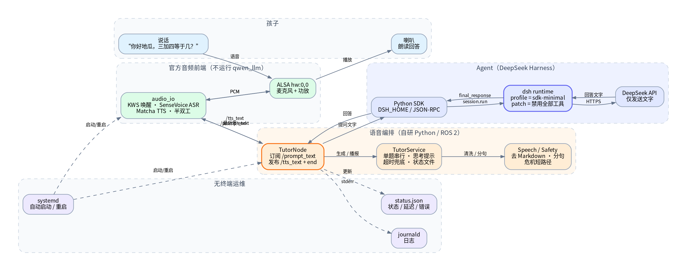

# 小地瓜老师 · RDK MagicBox 语音学习助手

把 RDK X5 MagicBox 变成一台**只有语音输入、喇叭输出**的小学生学习助手。

- **Agent**：DeepSeek Harness Python SDK（`sdk-minimal` profile，持久多轮会话）
- **语音**：官方 `audio_io`（KWS 唤醒 + SenseVoice ASR + Matcha TTS）
- **交互**：说“你好地瓜”唤醒 → 直接提问 → 喇叭回答 → 说“结束对话”休眠
- **重启保持会话**：默认恢复上次 DSH Session；说“重新开始”才新建
- **会话兼容保护**：切换 provider/model 或改人设后自动新建，避免旧历史把模型带偏
- **单字回答恢复**：较长问题只回 1—2 个字时，自动重置会话并重试一次
- **无终端**：运行时不读 stdin、不打印对话到 stdout；systemd 启动/重启
- **无工具 Agent**：模型不能读写文件、执行 shell、上网或改设备
- **安全**：自伤/被欺负/火灾等高风险话术走确定性短路径；人设限制隐私、暴力和代写作业



## 一句话数据流

```text
孩子说话
  → audio_io（KWS / ASR）
  → /prompt_text
  → TutorNode
  → DSH SDK（sdk-minimal + 禁用全部工具）
  → DeepSeek API
  → 回答文字
  → 清洗 / 分句
  → /tts_text（逐句）+ "end"
  → audio_io TTS
  → 喇叭
```

## 为什么这样设计

| 决策 | 原因 |
|---|---|
| 复用 `audio_io`，不自己写 ALSA | 官方已适配 MagicBox 的 I2S 麦克风/功放、KWS、ASR、TTS、半双工和灯效 |
| 不启动 `qwen_llm` | 用 DSH Agent 替换大模型；`audio_io` 设 `wait_for_llm:=false` 即可独立运行 |
| `sdk-minimal` + `voice-only.yml` | 纯对话、持久会话、自动压缩；同时禁用 bash/文件/工作目录工具 |
| Python 编排，ROS 只做桥 | 状态机/分句/安全策略迭代快；ROS 回调线程不被模型阻塞 |
| 逐句发 TTS | 模型返回后首句先播，不必等整段合成；`audio_io` 自动补“。”，所以发之前去掉句末标点 |
| 最后发 `"end"` | `audio_io` 靠它判断 TTS 结束并重新开麦；漏发会“说完就聋” |
| 独立 DSH_HOME | 不复用 Web 端保存的登录凭据，儿童设备会话/权限与开发环境隔离 |

## 快速开始

> 完整步骤见 [部署与排障](docs/部署与排障.md)。

前置：RDK X5 MagicBox、官方 RDK OS、`audio_io` 已安装、`arecord -l` 有声卡、能访问 DeepSeek API。

```bash
cd /home/sunrise/RDK-Dev
sudo ./scripts/install.sh
sudo nano /etc/magicbox-tutor.env     # 填入 DEEPSEEK_API_KEY
sudo systemctl restart magicbox-tutor
```

> 如果重启后日志出现 `EROFS` / `JsonRpcError`，先执行 `sudo mount -o remount,rw /`；这是根文件系统只读，不是 API key 问题。

验证：

```bash
systemctl status magicbox-tutor --no-pager
journalctl -u magicbox-tutor -n 50 --no-pager
cat /run/magicbox-tutor/status.json
```

如果启动失败，先运行：

```bash
sudo -u sunrise /opt/magicbox-tutor/scripts/doctor.sh
```

然后对设备说：

1. “你好地瓜”
2. “三加四等于几？”
3. “那七乘八呢？”
4. “结束对话”

## 配置

生产配置：`/etc/magicbox-tutor/config.yaml`  
人设：`/etc/magicbox-tutor/tutor_system_prompt.md`  
密钥：`/etc/magicbox-tutor.env`（权限 600）

常用项：

```yaml
agent:
  model: deepseek-flash
  max_tokens: 512
  answer_timeout_s: 75
  resume_session: true

behavior:
  wake_word: 你好地瓜
  thinking_filler_delay_s: 1.5
  max_answer_chars: 600
  max_sentence_chars: 80
  reset_phrases: [重新开始, 新对话, 换个话题]
```

改完执行 `sudo systemctl restart magicbox-tutor`。

## 换用千问百炼（可选）

**不能只把 `DEEPSEEK_BASE_URL` 改成百炼地址。** DSH 的 `sdk-minimal` 默认适配器走 Anthropic Messages 协议；百炼兼容模式是 OpenAI Chat Completions。需要加载 [qwen-bailian.yml](patches/qwen-bailian.yml)，用 `llm-pi-ai` 增加 Qwen 路由。

先确认你的 key 属于哪一种：

| Key 类型 | provider | 环境变量 | 端点 |
|---|---|---|---|
| 百炼 **Token Plan 个人订阅**（中国站） | `qwen-token-plan-cn` | `QWEN_TOKEN_PLAN_CN_API_KEY` | 内置（cn-beijing） |
| 百炼 **Token Plan 个人订阅**（国际站） | `qwen-token-plan-individual` | `QWEN_TOKEN_PLAN_API_KEY` | 内置（ap-southeast-1） |
| 普通百炼控制台 **API Key** | `qwen` | `DASHSCOPE_API_KEY` | `dashscope.aliyuncs.com/compatible-mode/v1` |

示例配置 [tutor.qwen.yaml](config/tutor.qwen.yaml) 默认使用**中国站 Token Plan 个人订阅**：

```bash
sudo cp /etc/magicbox-tutor/tutor.qwen.yaml /etc/magicbox-tutor/config.yaml
sudo nano /etc/magicbox-tutor.env
```

在 env 文件里写：

```dotenv
QWEN_TOKEN_PLAN_CN_API_KEY=sk-你的TokenPlan个人订阅Key
```

> 这里要填 Token Plan 控制台创建的 **API Key**（`sk-...`），不是阿里云 AccessKey ID/Secret。国际站换成 `QWEN_TOKEN_PLAN_API_KEY`，普通百炼 key 换成 `DASHSCOPE_API_KEY`。

如果只改现有配置的 `agent` 段：

```yaml
agent:
  provider: qwen-token-plan-cn
  model: qwen3.8-flash
  api_key_env: QWEN_TOKEN_PLAN_CN_API_KEY
  provider_patch_file: /opt/magicbox-tutor/patches/qwen-bailian.yml
```

重启后日志应出现：

```text
启动 DSH SDK: profile=sdk-minimal provider=qwen-token-plan-cn model=qwen3.8-flash
```

Token Plan 路由使用 pi-ai 内置目录，`qwen3.8-flash` / `qwen3.7-plus` / `qwen3.7-max` 等模型无需在 patch 里逐条列出；普通 `qwen` 路由在 `patches/qwen-bailian.yml` 里列了 `qwen3.8-flash` / `qwen-plus` / `qwen-turbo`，可按控制台可用列表增删。切换 provider 后旧 Session 若不能恢复，会自动新建；想给两个平台各自独立的历史，用不同的 `dsh_home`。

## 项目结构

```text
src/magicbox_tutor/
├── __main__.py       # 无终端入口；--check 只校验配置
├── config.py         # YAML + 环境变量
├── agent.py          # DSH SDK 适配、Session、无工具补丁
├── dialog.py         # 归一化、重置词、安全短路径
├── safety.py         # 高风险话术
├── speech.py         # Markdown/URL/公式清洗、分句、限长
├── service.py        # 单题串行、思考提示、超时、TTS
├── ros_node.py       # /prompt_text -> /tts_text 桥
└── status.py         # 无转录状态文件

config/               # 生产/开发配置、人设
patches/voice-only.yml# 禁用所有模型工具
patches/qwen-bailian.yml# 可选：千问百炼 pi-ai 路由
scripts/              # install / run / uninstall
systemd/              # 两个服务单元
tests/                # 单元测试
tools/                # 仅开发用模拟器
docs/                 # 方案、部署排障、架构图
```

## 开发与测试

```bash
# 纯单元测试（不需要声卡/API key）
python3 -m pytest -q

# 校验配置
PYTHONPATH=src python3 -m magicbox_tutor --check --config config/tutor.dev.yaml

# 不调用模型的对话模拟（开发用）
PYTHONPATH=src python3 tools/simulate_dialog.py \
  --config config/tutor.dev.yaml --fake \
  --text "你好地瓜，三加四等于几？"
```

在 RDK X5（aarch64）上已做过的验证：

- Python 3.10 + `rclpy` 导入；
- `deepseek-harness-sdk 0.2.1rc2` 的 `sdk-minimal` runtime 启动；
- `voice-only.yml` 补丁成功禁用 `persistent-bash` / `tool-fs` / `tool-working-directory`，并关闭 session-log 上传；
- `sdk-minimal + qwen-bailian.yml` 的 runtime 初始化通过（`provider=qwen-token-plan-cn, model=qwen3.8-flash`）；
- 41 项单元测试通过（含重启恢复会话、恢复失败回退、关闭恢复、Qwen provider patch）。

**未在真实 MagicBox 音频硬件上做完整回声/唤醒测试**（当前开发板 `arecord -l` 无声卡）。首次上机请按部署文档检查声卡、KWS、TTS，并做 2 小时 soak。Qwen 的真实模型请求也需要你的百炼 key 才能最终验证；当前已验证的是 runtime 初始化与 provider 路由。

## 安全与隐私

- 音频在板端转文字，**音频不上传**；文字会发给 DeepSeek API。
- 模型没有 shell/文件/网页工具；语音输入不能变成设备操作。
- 高风险话术（自伤、被欺负、火灾/触电等）不交给模型自由发挥，直接给“找大人/拨打 110、119、120”的固定回答。
- 默认不记录孩子原话到 journal；DSH 会话 JSONL 存在 `/userdata/magicbox-tutor/dsh-home/sessions`（权限 700）。
- `voice-only.yml` 同时禁用 `session-log-deepseek`，避免 DSH 把未接受的会话日志事件上传给模型提供方。
- 不询问/保存真实姓名、学校、住址、电话、照片；不推荐充值/外部链接。

## 文档

- [语音助手方案](docs/语音助手方案.md)
- [部署与排障](docs/部署与排障.md)
- [此前的方案与选型](docs/方案与选型.md)

## 恢复官方演示

```bash
sudo systemctl disable --now magicbox-tutor magicbox-tutor-audio
sudo systemctl enable --now magicbox-start
```
