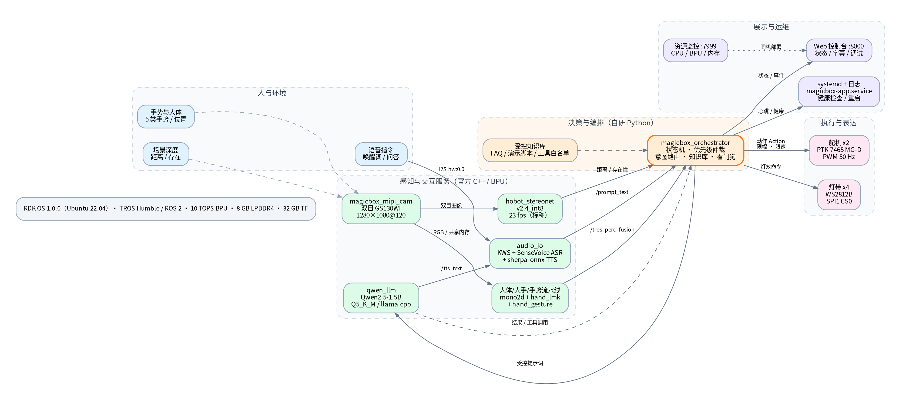
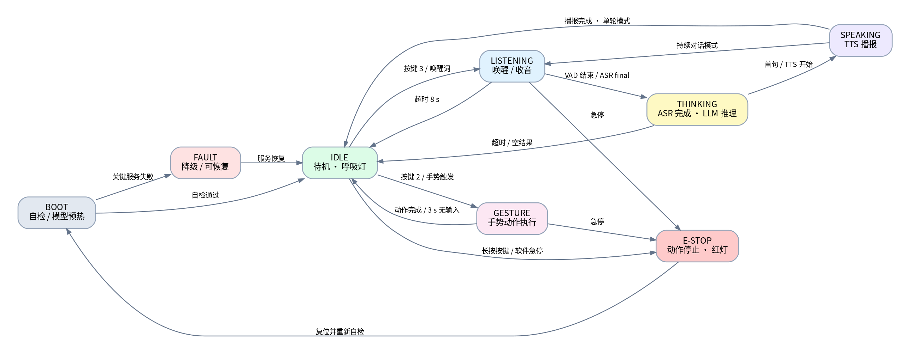

# RDK X5 MagicBox 开发方案与选型建议

> 版本：v0.1（方案草案）  
> 日期：2026-11-04  
> 适用硬件：D-Robotics RDK X5 MagicBox（RDK X5 8G + GS130WI 双目相机 + 双舵机 + 灯带/麦克风/扬声器）  
> 文档定位：在写代码之前，先把**场景、架构、技术栈、接口、节奏和风险**定下来。  
> **2026-11-07 更新：** 项目方向已调整为“小学生学习语音助手”，实施代码与最新方案见 [语音助手方案](语音助手方案.md)。本文保留为早期多模态展台方案，供架构/选型参考。
>
> 说明：本文默认“尚未指定具体业务场景”，因此给出一个推荐主场景；如果你已有明确场景，第 2 节可直接替换，第 3–8 节的架构、选型和工程方法仍然适用。

---

## 0. 结论摘要

先给结论，后面再展开论证。

| 决策项 | 建议 | 一句话理由 |
|---|---|---|
| 首选场景 | **多模态展台讲解员/互动助手** | 能同时用上双目、手势、语音、LLM、舵机和灯效，演示完整且不需要额外机械臂 |
| 系统底座 | **预置 RDK OS 1.0.0（Ubuntu 22.04 + TROS Humble）** | 官方镜像已带相机、BPU、音频、ROS 2 和示例，重新造轮子风险高 |
| 架构风格 | **官方能力包 + 自研编排层** | 相机/深度/手势/ASR/TTS/LLM 复用官方 C++ 包，业务状态机用 Python 快速迭代 |
| 主语言 | **Python 做编排，C++ 做执行器** | Python 改行为快；舵机/灯效/高频控制放 C++，避免 Python GC 和调度抖动 |
| 感知 | **深度用 `hobot_stereonet` v2.4_int8，手势用官方 hand pipeline** | 官方已针对 X5 BPU 量化，默认 23 fps 深度；自训模型留到第二阶段 |
| 语音 | **SenseVoice ASR + sherpa-onnx KWS/TTS + Qwen2.5-1.5B（Q5_K_M）** | 全离线、链路成熟；1.5B 只负责闲聊和润色，关键动作走规则/知识库 |
| 交互控制 | **“快慢双环”**：手势反射环 30 Hz，语音认知环秒级 | 避免 LLM/TTS 阻塞舵机，也避免舵机抖动影响语音 |
| UI | **Web 控制台（:8000 视频 + 自研 :8081 状态页）**，HDMI 仅备用 | 展台部署不需要额外显示器，手机/平板即可看状态 |
| 部署 | **独立 `magicbox-app.service`，不修改官方目录** | 可回滚、可升级，避免和 `magicbox-start` 抢相机/音频/模型 |
| 交付节奏 | **6 周做出可演示版本**（按 1.5～2 人投入估算） | 先打通一条竖切，再扩展，不搞“大爆炸式”集成 |

**最重要的三条判断：**

1. **不要把 Qwen2.5-1.5B 当成“产品知识库”。** 它适合寒暄、改写、简短问答；展台讲解的事实性内容应放在受控 FAQ/脚本里，由意图路由决定是否调用 LLM。
2. **不要让语音链路和舵机链路互相等待。** 官方 `audio_io` 与 `qwen_llm` 默认会互相阻塞等待；自定义应用必须把“反射”和“认知”拆开。
3. **不要用深度图做安全急停。** 双目是感知传感器，不是安全传感器；急停必须走按键/软件状态机，并配合舵机限幅、限速和超时。

---

## 1. 硬件基线：它到底能做什么、不能做什么

以下为官方资料中的关键事实（文末附来源）。

### 1.1 计算与接口

| 项目 | 规格 | 对开发的含义 |
|---|---|---|
| 主控 | RDK X5 8G | 8× Cortex-A55，BPU 10 TOPS（INT8），GPU 32 GFLOPS，8 GB LPDDR4 |
| 存储 | 板载 1 Gbit NAND + 32 GB TF 卡 | 系统、模型、日志都在 TF 上；注意卡寿命和剩余空间 |
| 网络 | 千兆以太网、Wi-Fi 6、BT 5.4 | 展台优先用有线；Wi-Fi 只做调试/备用 |
| USB | 4× USB 3.0 Type-A，1× USB 2.0 Type-C（设备） | 可接键鼠、U 盘、USB 音频；注意供电余量 |
| 显示 | HDMI 最高 1080p@60 | 现场可接显示器，但建议 Web 为主 |
| 供电 | 5 V / 5 A，Type-C，要求 PD 3.0 | **必须用合规 PD 3.0 电源**；供电不足会导致手势卡死、摇臂持续摆动（官方 FAQ 明确提到） |

### 1.2 感知与执行器

| 部件 | 关键规格 | 开发含义 |
|---|---|---|
| 双目相机 GS130WI | 双 SC132GS 全局快门，单路 1280×1080@120 fps，基线 70 mm，对角线 FOV 157.2°，板载 ICM-42688-P IMU | 近距深度和手势都可用；全局快门适合运动；基线 70 mm，近处（约 <0.3 m）易受遮挡和标定误差影响，需实测确认 |
| 舵机 PTK 7465 MG-D ×2 | ±180°，堵转扭矩 3.8–5.8 kg·cm，空心杯电机 | 只能做“摇臂/撑起/举手”等表意动作，**不是机械臂，不能抓取** |
| 灯带 | 4× WS2812B，SPI1 CS0 | 可做状态色：官方语义是红=深度、绿=手势、蓝=语音，建议沿用 |
| 按键 | 3 个，GPIO 22/16/26，低电平触发 | 可做模式切换、语音启动、急停 |
| 音频 | I2S `hw:0,0`，麦克风 INMP441，功放 NS4168 | 单麦、无回声消除硬件；必须做半双工/唤醒词策略 |
| 扩展 IMU | ICM20948，I2C5 | 可做倾斜/碰撞检测，但展台场景不是必需 |

### 1.3 官方软件基线

- 预置 RDK OS，官方文档标注首版 **RDK OS 1.0.0（2026-03-05）**。
- 预置 ROS 2（TROS Humble）、双目深度、手势交互、语音交互案例，以及资源监控 Web 应用。
- 官方目录：`/userdata/magicbox/`，包含 `app/ros_ws`、`basic_function_demo`、`config`、`dep`、`launch`、`voice` 等。
- 网络与端口：
  - 闪连口：`192.168.128.10`，Web 视频 `:8000`，资源监控 `:7999`
  - 有线网口：`192.168.127.10`，端口同上
- 自启动：`systemctl enable/disable magicbox-start`。

> **开发第一原则：把官方目录当成“只读的 BSP/示例”。** 自研代码放独立 overlay（如 `/userdata/magicbox_app`），通过 launch 和 remap 接入；这样官方升级时不需要合并代码。

### 1.4 边界：这套硬件不适合做什么

- **不适合做移动机器人导航/SLAM**：没有轮式底盘、激光雷达和电池，供电是桌面级。
- **不适合做抓取/精细操作**：只有两个开环舵机，没有夹爪、力/位反馈。
- **不适合做安全级检测**：双目深度和手势都不是安全认证传感器。
- **不适合长时间离电运行**：需要 PD 电源，展台要预留走线和防绊倒。
- **不适合在强噪声/多人同时说话的环境做远场语音**：单麦，官方也建议安静环境。

---

## 2. 场景选型：为什么选“多模态展台讲解员”

### 2.1 候选场景对比

评分 1–5，越高越好；权重按“演示项目”而非量产项目设定。

| 场景 | 硬件适配 25% | 演示效果 25% | 开发成本 20% | 技术风险 20% | 扩展性 10% | 加权分 |
|---|---:|---:|---:|---:|---:|---:|
| A. 多模态展台讲解员（推荐） | 5 | 5 | 4 | 3 | 4 | **4.30** |
| B. 手势控制动作/小剧场 | 4 | 3 | 5 | 4 | 3 | 3.85 |
| C. 纯语音问答助手 | 4 | 3 | 4 | 4 | 4 | 3.75 |
| D. 双目存在/距离感知 Demo | 5 | 3 | 3 | 3 | 5 | 3.70 |
| E. 视觉质检/分拣 | 2 | 2 | 1 | 2 | 3 | 1.90 |

**结论：A 作为主场景，B/C/D 作为它的子能力。** 这样演示有主线，但每一块都能单独降级：

- 语音链路出问题 → 仍可用按键 + 手势 + 灯效演示。
- LLM 延迟高 → 用脚本化讲解 + FAQ 兜底。
- 深度受光照影响 → 只做“有人/无人”粗粒度触发，不吹精度。
- 网络断开 → 全离线仍可运行。

### 2.2 推荐场景：MagicBox 多模态讲解员

**一句话：** 观众靠近时，MagicBox 用灯效和动作“注意到”他；观众说“你好地瓜”后，它用语音介绍展项；观众比手势，它用摇臂/灯光回应；讲解结束自动回到待机。

**用户旅程：**

1. **待机**：白色呼吸灯，摇臂收拢，深度感知开启但低频运行。
2. **迎宾**：有人在 0.8–2.5 m 内停留 > 1 s → 灯效变蓝、播放短问候、摇臂轻摆。
3. **对话**：说“你好地瓜”唤醒 → 蓝灯常亮 → 收音 → ASR → 意图路由 → 脚本回答或 LLM 回答 → TTS 播报。
4. **手势互动**：观众比“点赞/V/左/右/OK” → 绿灯 → 对应动作/灯效；动作期间麦克风降低灵敏度，避免误唤醒。
5. **结束**：说“结束对话”或 30 s 无交互 → 回到待机；连续对话模式可配置。
6. **异常**：长按任一按键 2 s → 急停，舵机回中/放松，红灯；再长按复位。

### 2.3 功能需求（FR）

| 编号 | 需求 | 验收口径 |
|---|---|---|
| FR-01 | 按键/唤醒词启动语音交互 | 按键 3 或“你好地瓜”均可进入 LISTENING；误唤醒 ≤ 1 次/小时（安静展台） |
| FR-02 | 多轮/单轮对话可配置 | 单轮：一次问答后回待机；多轮：TTS 结束后 8 s 内可继续 |
| FR-03 | 5 类手势映射到动作/灯效 | 每类手势 10 次测试，成功 ≥ 8 次；误触发 ≤ 1 次/10 分钟 |
| FR-04 | 深度存在感知 | 0.8–2.5 m 有人停留 1 s 触发迎宾；无人 30 s 回待机；不输出“精确测距”承诺 |
| FR-05 | 动作库 | 至少 6 个动作：问候、摇臂、撑起、左举、右举、闪烁；全部限幅限速 |
| FR-06 | 灯效状态机 | 待机白呼吸、语音蓝、手势绿、深度红、故障红闪；与官方语义一致 |
| FR-07 | Web 控制台 | 显示状态、字幕、延迟、服务健康；可手动触发模式/急停 |
| FR-08 | 运维 | 开机自启、看门狗、日志轮转、一键部署/回滚 |
| FR-09 | 安全 | 软急停、舵机占空比上限、动作超时、断网不影响本地运行 |

### 2.4 非功能目标（NFR，建议值，需实测）

| 指标 | 目标 | 测量方法 |
|---|---|---|
| 唤醒→开始收音 | < 300 ms | 打点日志/示波器辅助 |
| 说完→ASR final | < 800 ms（p95） | 录音文件回放 + 时间戳 |
| ASR final→首 token | < 1.5 s（p95） | 日志时间戳 |
| 首 token→TTS 首包 | < 500 ms | 日志时间戳 |
| 手势识别→舵机动作 | < 150 ms | 高速摄像/逻辑分析仪 |
| 连续运行 | 2 h 无重启、无 OOM | soak test |
| 内存峰值 | < 85% | `free`/资源监控 |
| 温度 | 30 min 不降频 | 外壳温度 + `dmesg`/频率 |
| 演示成功率 | 主流程 ≥ 95% | 50 轮脚本化彩排 |

> 这些是**验收目标**，不是官方承诺。第一周必须先测基线，再决定是否调整。

---

## 3. 系统架构

### 3.1 总体架构图



图中三条关键边界：

1. **感知/交互服务层**尽量复用官方 C++/BPU 包，不改模型、不改驱动。
2. **决策编排层**是自研 Python，负责状态、优先级、知识库、安全策略。
3. **执行层**是自研 C++ 小节点，复用官方 `servo_control` / `lighting_control` 库，但**不复用官方行为节点**，以便统一限幅和仲裁。

### 3.2 为什么是“快慢双环”

| 环路 | 周期 | 内容 | 不能做什么 |
|---|---|---|---|
| 快环（反射） | 30–60 Hz | 相机→手势/人体→动作；按键→急停；灯效 | 不等待 ASR/LLM/TTS |
| 慢环（认知） | 0.5–5 s | 唤醒→ASR→意图→LLM/知识库→TTS | 不直接控制舵机，只发“动作意图” |

官方 `gesture_interaction` 是“订阅 `/tros_perc_fusion` 后直接控舵机”的直连结构，延迟低，但没有统一仲裁。自研执行器要把这个直连改成 **Action + 优先级队列**：

- 急停 > 用户按键 > 手势 > 语音动作 > 自动迎宾 > 待机灯效。
- 高优先级可抢占低优先级；抢占时先减速/回中，再执行新动作。
- 所有动作有超时（建议 3 s）和冷却（建议 0.5 s），避免舵机连续堵转。

### 3.3 建议的进程/节点划分

| 节点/进程 | 语言 | 来源 | 职责 |
|---|---|---|---|
| `magicbox_mipi_cam` | C++ | 官方 | 双目采集、畸变校正、发布图像/相机信息 |
| `hobot_stereonet` | C++/BPU | 官方 | 双目深度，`v2.4_int8` 默认 23 fps（标称） |
| `mono2d_body_detection` | C++/BPU | 官方 | 人体检测 |
| `hand_lmk_detection` | C++/BPU | 官方 | 人手关键点 |
| `hand_gesture_detection` | C++/BPU | 官方 | 手势分类，融合到 `/tros_perc_fusion` |
| `audio_io` | C++ | 官方 | KWS、ASR、TTS、音频半双工 |
| `qwen_llm` | C++ | 官方 | Qwen2.5-1.5B 推理，发布文本 |
| `magicbox_actuator` | C++ | **自研** | 舵机/灯效 Action、限幅、限速、急停 |
| `magicbox_orchestrator` | Python | **自研** | 状态机、意图路由、知识库、优先级、看门狗 |
| `magicbox_web` | Python | **自研** | FastAPI + WebSocket 状态页/控制 |
| `hobot_websocket` | C++ | 官方 | 视频/算法结果 Web 渲染（:8000） |
| 资源监控 | C++/Web | 官方 | CPU/BPU/内存（:7999） |

### 3.4 话题与服务契约

官方已确认的接口（来自官方仓库/文档）：

| 方向 | 话题 | 类型 | 说明 |
|---|---|---|---|
| ASR 输出 | `/prompt_text` | `std_msgs/msg/String` | `audio_io` 发布识别文本，默认直接给 `qwen_llm` |
| TTS 输入 | `/tts_text` | `std_msgs/msg/String` | `audio_io` 接收待播报文本 |
| 手势融合 | `/tros_perc_fusion` | `ai_msgs/msg/PerceptionTargets` | 官方手势控制节点订阅 |
| 功能调用 | `/fc_text` | `std_msgs/msg/String` | 官方 `fc_call_node` 订阅，格式为 `{[left_control][30]}` 一类 |
| 相机信息 | `/image_combine_raw/right/camera_info` | `sensor_msgs/msg/CameraInfo` | 深度启动示例中的参数 |

自研建议新增：

| 方向 | 话题/接口 | 类型 | 说明 |
|---|---|---|---|
| 状态 | `/magicbox/state` | `magicbox_interfaces/msg/InteractionState` | 当前状态、置信度、错误码 |
| 事件 | `/magicbox/event` | `magicbox_interfaces/msg/BehaviorEvent` | 唤醒、手势、超时、故障 |
| 动作 | `/magicbox/action` | `magicbox_interfaces/action/ExecuteAction` | goal/feedback/result，带速度、超时 |
| 灯效 | `/magicbox/light` | `magicbox_interfaces/srv/SetLight` | 颜色、模式、时长 |
| 健康 | `/magicbox/health` | `magicbox_interfaces/msg/Health` | 各节点心跳、延迟、资源 |
| 控制台 | `GET /api/state`、`WS /ws` | HTTP/WebSocket | 只监听内网，默认无鉴权但绑定 `127.0.0.1`/内网 |

**关键 remap 设计：** 不要让 `qwen_llm` 直接写 `/tts_text`，否则编排层无法拦截。建议：

```text
audio_io:  /prompt_text  ->  /magicbox/asr
           /tts_text    <-  /magicbox/tts
qwen_llm:  /prompt_text  <-  /magicbox/prompt
           /tts_text     ->  /magicbox/llm_text
```

编排层订阅 `/magicbox/asr` 和 `/magicbox/llm_text`，按规则决定“直接脚本回答”还是“转发 LLM 输出”，再发布到 `/magicbox/tts`。这样既能拦截不当内容，也能在 LLM 超时时用脚本兜底。

> **两个集成坑：**
> 1. `qwen_llm` 会发布 `end` 一类控制消息，官方 `audio_io` 靠它判断 TTS 结束并重新开麦。编排层转发时必须**原样透传控制消息**，不能只转发正文，否则会出现“说完就聋”。
> 2. `audio_io` 和 `qwen_llm` 默认互相阻塞等待。正式 launch 要让它们同时启动（或用 `wait_for_llm`/`wait_for_audio` 明确控制）；不要先起一个再手工起另一个，否则会卡在等待日志上。

### 3.5 状态机



状态机原则：

- **单一权威**：只有 `orchestrator` 能写 `/magicbox/state`；执行器只反馈动作结果。
- **可恢复**：FAULT 不是终态；服务恢复后回 IDLE，并记录原因。
- **急停独立**：ESTOP 由按键中断和软件命令共同触发，不依赖 ROS 主循环；执行器收到后立即停止 PWM 更新并回安全位。
- **超时兜底**：LISTENING 8 s、THINKING 10 s、SPEAKING 30 s、GESTURE 3 s，超时回 IDLE。

---

## 4. 技术选型与取舍

### 4.1 选型总表

| 领域 | 选择 | 理由 | 不选/备选 |
|---|---|---|---|
| OS | RDK OS 1.0.0（Ubuntu 22.04） | 官方驱动、BPU 运行时、TROS 已适配 | 通用 Ubuntu 22.04：驱动/固件适配成本高 |
| 中间件 | TROS Humble / ROS 2 | 官方包都是 ROS 2 节点；工具链成熟 | 裸进程 + ZeroMQ：失去 rosbag/launch/生态 |
| DDS | CycloneDDS | 官方 `audio_io` launch 已设置 `RMW_IMPLEMENTATION=rmw_cyclonedds_cpp` | FastDDS 也可，但不要混用 |
| 编排语言 | Python 3.10 | 状态机/规则/知识库迭代快；测试方便 | 全 C++：开发慢；全 Python 控舵机：抖动风险 |
| 执行器语言 | C++17 | 复用 `servo_control`/`lighting_control`，实时性可控 | Python `gpiozero`：依赖和抖动不可控 |
| 视觉推理 | 官方 `hobot_dnn` / BPU + Model Zoo | 已量化、已适配 X5；省去转换/调优 | ONNX Runtime CPU：帧率低、占 CPU |
| 深度 | `hobot_stereonet` v2.4_int8 | 官方标称 23 fps，适合实时；int16 15 fps 可按需切换 | 自训深度：数据/算力/时间都不划算 |
| 手势 | 官方 hand pipeline + `/tros_perc_fusion` | 5 类手势开箱可用；全局快门友好 | 自训 YOLO+关键点：第一阶段不必 |
| ASR | SenseVoice（GGUF） | 官方集成，中文识别可用，离线 | 云端 ASR：网络/隐私/延迟不可控 |
| KWS | sherpa-onnx zipformer 3.3M | 轻量、离线、可配置唤醒词 | 纯 ASR 轮询：误触发和功耗高 |
| TTS | sherpa-onnx Matcha 中文 | 离线、自然度够演示 | 云端 TTS：依赖网络 |
| LLM | Qwen2.5-1.5B-Instruct Q5_K_M + llama.cpp | 8 GB 内存可跑，官方已适配；离线 | 7B：内存/速度不现实；纯云端：断网即挂 |
| 知识库 | YAML/JSON FAQ + BM25/模糊匹配 | 可控、可审阅、零额外模型；解决 1.5B 事实性不足 | 向量库 + embedding：多一个模型，收益有限 |
| Web | FastAPI + 原生 HTML/JS | 轻量、易改、易部署 | React/Vue 全家桶：对 demo 过重 |
| 视频 Web | 官方 `hobot_websocket` :8000 | 已带图像/算法渲染 | 自研 WebRTC：成本高 |
| 构建 | 板端 `colcon build` + 纯 Python 包 | 官方推荐；无需交叉编译 | 交叉编译：首版不值得 |
| 部署 | systemd + rsync + 版本化目录 | 简单、可回滚 | Docker：BPU/相机设备透传增加复杂度 |
| 日志 | ROS 日志 + JSONL + logrotate | 可观测、可回放 | 只看 stdout：排障困难 |

### 4.2 关键取舍说明

#### ① 为什么“复用官方包，但重写行为节点”

官方 `gesture_interaction` 的价值是**验证硬件和算法链路**，不是最终业务架构：

- 它直接订阅 `/tros_perc_fusion` 并控舵机，没有统一优先级/急停/超时。
- 它的动作是硬编码的，不适合“讲解员”场景。
- 它的手势/动作语义与展台脚本不一定匹配。

因此建议：

- **复用**：`servo_control`（PWM 封装）、`lighting_control`（WS2812B 封装）、`hobot_dnn`、相机/手势/语音包。
- **重写**：`magicbox_actuator`（Action + 限幅/限速/急停）、`magicbox_orchestrator`（状态机/路由）。
- **保留**：官方 `gesture_interaction` 作为对照实验，不进入最终 launch。

#### ② 为什么 LLM 只做“受控生成”

Qwen2.5-1.5B 在 8 GB 板端能跑，但：

- 事实性知识有限，容易“编”展项信息。
- 首 token 延迟和输出稳定性受 prompt 长度影响。
- 官方默认关闭 function call，因为 prompt 开销大、初始化慢。

建议策略：

1. **意图路由优先**：问候、展项介绍、控制动作、结束对话等高频意图走规则/模板。
2. **知识库兜底**：50–100 条 FAQ，命中则直接回答；未命中才交给 LLM。
3. **LLM 白名单**：只允许“闲聊、改写、简短解释”；不允许 LLM 直接生成舵机指令。
4. **输出过滤**：长度上限、敏感词、禁止 URL/代码；超时 8 s 直接切脚本。
5. **可选云 fallback**：默认关闭；开启时只发文本，不发音频/图像。

#### ③ 为什么深度默认 int8

官方数据：

| 模型 | 量化 | 输入 | 最高帧率（标称） | 用途 |
|---|---|---|---|---|
| V2.4_int16 | int16 | 640×352×3×2 | 15 fps | 高精度 |
| V2.4_int8 | int8 | 640×352×3×2 | 23 fps | 高帧率，默认 |

展台场景只需要“有人/距离档位”，int8 足够；如果要做近距测量/精细演示，再切 int16，并接受帧率下降。**不要同时常驻两套深度模型**，BPU 和内存都吃不消。

#### ④ 为什么音频必须半双工

单麦、无硬件 AEC，扬声器播放时如果继续开麦，TTS 会被自己的声音触发 ASR，形成“自问自答”。官方 `audio_io` 已经采用“ASR 完成后关麦→TTS 完成收到 `end` 再开麦”的半双工逻辑。

自研编排层要遵守：

- SPEAKING 状态关闭/降低 KWS 灵敏度。
- TTS 结束后留 200–300 ms 静默再开麦。
- 不支持“边播边说”的 barge-in（首版）；要做必须加 AEC 或定向麦。

#### ⑤ 为什么 Web 而不是原生 GUI

- 展台部署通常没有多余 HDMI 显示器。
- Web 可以手机/平板/笔记本访问，方便调试和观众看字幕。
- 官方已经提供 :8000 视频页和 :7999 资源监控，自研只需补状态/控制页。
- 原生 Qt 增加交叉编译/依赖/触摸适配成本，收益低。

---

## 5. 资源与性能预算

> 以下是**预算/目标**，不是实测值。第一周必须用板端数据替换。

### 5.1 内存预算（8 GB）

| 项目 | 预算上限 | 说明 |
|---|---:|---|
| OS + TROS + 基础服务 | 1.5 GB | Ubuntu + DDS + systemd |
| 相机/深度/手势运行时 | 1.5 GB | 含图像缓冲、模型、共享内存 |
| ASR + KWS + TTS | 0.8 GB | SenseVoice + sherpa-onnx |
| LLM（Qwen2.5-1.5B Q5_K_M） | 1.5 GB | 模型放 `/dev/shm`，会占 RAM；文件约 1.1 GB 量级，需实测 |
| 自研服务 + Web | 0.3 GB | Python/FastAPI |
| 文件缓存/峰值余量 | 1.5 GB | 防止 OOM |
| **合计** | **7.1 GB** | 留 ~0.9 GB 安全边际 |

注意：

- `/dev/shm` 默认可能是 RAM 的一半；先 `df -h /dev/shm`，确认能放下模型。
- LLM 放 `/dev/shm` 是为了避免每次按键都从 TF 加载，但会长期占内存；如果内存紧张，改为按需加载。
- 不建议开 zram/swap 硬扛；TF 卡 swap 会拖慢并加速磨损。

### 5.2 BPU/CPU 预算

| 负载 | 建议 | 原因 |
|---|---|---|
| 深度 | 15–23 fps，按场景降频 | 与手势/人体检测共享 BPU |
| 手势/人体 | 与深度错峰或降帧 | 官方标称帧率是单模型理想值，不是并发值 |
| ASR/TTS | CPU 为主 | 与 BPU 争抢较小，但内存带宽有影响 |
| LLM | CPU 为主 | 1.5B Q5_K_M 在 A55 上速度有限，需实测 token/s |
| 控制环 | 30–60 Hz | 优先级最高；不要被 Python GC 卡住 |

**调度策略：**

- IDLE：深度 5 fps + 人体检测低频；手势关闭。
- LISTENING/THINKING/SPEAKING：深度降到 5 fps 或暂停；保证音频/LLM。
- GESTURE：手势/人体全速；深度暂停。
- 所有模式：控制环和急停始终运行。

### 5.3 存储预算（32 GB）

| 项目 | 预算 |
|---|---:|
| 系统 + 官方应用 | 12–15 GB |
| 模型（LLM/ASR/TTS/KWS/视觉） | 3–5 GB |
| 自研代码/日志/录包 | 3–5 GB |
| 余量（建议 ≥ 20%） | 6 GB+ |

日志策略：JSONL + ROS 日志，按天轮转，保留 7 天；演示前清空。不要长期把 rosbag 写满 TF。

---

## 6. 工程结构建议

```text
RDK-Dev/
├── README.md
├── docs/
│   ├── 方案与选型.md
│   ├── 接口契约.md
│   ├── 部署与回滚.md
│   └── assets/
├── src/
│   ├── magicbox_interfaces/        # msg / srv / action
│   ├── magicbox_orchestrator/      # Python 状态机/路由/知识库
│   ├── magicbox_actuator/          # C++ 舵机/灯效 Action
│   ├── magicbox_web/               # FastAPI + 静态页
│   └── magicbox_bringup/           # launch / config / systemd
├── config/
│   ├── behavior.yaml               # 超时、阈值、优先级
│   ├── actuators.yaml              # 舵机限幅/初始位/动作库
│   ├── knowledge/faq.yaml          # 受控知识库
│   └── calibration/                # 相机/舵机标定结果
├── scripts/
│   ├── bootstrap.sh                # 依赖检查/目录初始化
│   ├── deploy.sh                   # rsync + build + restart
│   ├── rollback.sh
│   └── healthcheck.sh
├── test/
│   ├── unit/                       # 状态机/路由/过滤
│   ├── integration/                # launch + fake nodes
│   └── hil/                        # 硬件在环脚本
└── third_party/                    # 只放锁定版本的说明，不 vendoring
```

**版本策略：**

- 官方包用 tag/commit 锁定，例如 `hobot_stereonet` 的 `magicbox-v1.0.0` 分支；不要跟 `develop` 漂移。
- 自研代码用 `v0.x` tag；每次演示前打 tag。
- 配置与代码分离；现场只改 `config/`，不改代码。

---

## 7. 接口与配置草案

### 7.1 行为配置（示例）

```yaml
# config/behavior.yaml
state:
  listening_timeout_s: 8
  thinking_timeout_s: 10
  speaking_timeout_s: 30
  gesture_timeout_s: 3
  idle_after_s: 30

audio:
  wake_word: "你好地瓜"
  continuous_wake_mode: false
  half_duplex: true
  tts_end_silence_ms: 250

gesture:
  min_confidence: 0.75
  debounce_frames: 3
  cooldown_s: 0.8
  enabled_states: ["IDLE", "GESTURE"]

depth:
  enabled_states: ["IDLE", "LISTENING"]
  presence_zone_m: [0.8, 2.5]
  presence_hold_s: 1.0
  idle_fps: 5
  active_fps: 15

llm:
  enabled: true
  timeout_s: 8
  max_output_chars: 200
  allow_cloud_fallback: false
```

### 7.2 舵机配置（示例）

```yaml
# config/actuators.yaml
servo:
  pwm_freq_hz: 50
  min_duty: 4.0
  max_duty: 12.0
  max_slew_duty_per_s: 4.0
  action_timeout_s: 3.0
  cooldown_s: 0.5
  initial: {left: 9.0, right: 7.0}

actions:
  greet:
    left: [9.0, 10.5, 9.0]
    right: [7.0, 5.5, 7.0]
    duration_s: 1.2
  stand:
    left: [9.0, 6.0]
    right: [7.0, 10.0]
    duration_s: 1.5
  left_raise:
    left: [9.0, 12.0]
    right: [7.0, 7.0]
    duration_s: 0.8
  right_raise:
    left: [9.0, 9.0]
    right: [7.0, 4.0]
    duration_s: 0.8
```

> 占空比数值必须按实物标定，不要直接照搬；不同批次舵机中位不同。上电先做“低速小角度”测试。`stand` 这类需要保持姿态的动作，保持时间单独配置，建议不超过 5 s，避免长时间堵转；保持结束后主动回中。

### 7.3 动作 Action 草案

```text
# ExecuteAction.action
string gesture          # greet / stand / left_raise / right_raise / shake / blink
float32 speed           # 0.0–1.0
float32 timeout_s       # 0 表示用默认
---
bool success
string message
---
string phase            # moving / holding / returning
float32 progress        # 0.0–1.0
```

### 7.4 Web API 草案

| 方法 | 路径 | 用途 |
|---|---|---|
| GET | `/api/state` | 当前状态、字幕、错误码 |
| GET | `/api/health` | 节点心跳、延迟、CPU/内存 |
| GET | `/api/config` | 只读配置（脱敏） |
| POST | `/api/mode` | 切换 idle/voice/gesture/depth（需内网） |
| POST | `/api/estop` | 急停（幂等） |
| WS | `/ws` | 状态/事件/字幕推送 |

安全：默认绑定 `127.0.0.1` 或展台内网；不要暴露到公网；写操作要求简单 token（环境变量注入）。

---

## 8. 六周落地路线图

> 假设 1.5–2 人：1 名 ROS/机器人工程师 + 1 名应用/AI 工程师，UI 和测试兼职。全职可压缩到 4 周。

### 第 1 周：基线、备份、护栏

**目标：** 确认硬件/系统/官方链路都能跑，建立“可回滚”的开发环境。

- 用 PD 3.0 5V/5A 电源，有线网连接，确认 `ping 192.168.127.10`。
- 备份原 TF 卡镜像（Win32DiskImager/`dd`），记录 RDK OS 版本。
- 跑通官方三个示例：深度、手势、语音；记录启动时间、帧率、内存、温度。
- `systemctl disable magicbox-start`，避免和自研应用抢相机/音频/模型；但要用自研 launch 按需拉起 `hobot_websocket` 和资源监控节点，否则 :8000/:7999 也会一起消失。
- 建立仓库骨架、CI（lint/unit）、部署脚本。
- 输出《基线测量报告》：实际 FPS、首 token 延迟、内存峰值、CPU/BPU 占用、温度。

**退出标准：** 三个示例可重复运行；有镜像备份；知道瓶颈在哪。

### 第 2 周：语音竖切（不接 LLM）

**目标：** 按键→录音→ASR→脚本回答→TTS 全链路跑通。

- 启动 `audio_io`，用 `arecord`/`aplay` 验证 `hw:0,0`。
- 自研 `orchestrator` 最小状态机：IDLE→LISTENING→THINKING→SPEAKING→IDLE。
- 5 条脚本问答 + 唤醒词 + 超时。
- Web 状态页显示状态和 ASR 文本。
- 记录 ASR 延迟、TTS 延迟、误唤醒。

**退出标准：** 按键说“介绍展项”能听到脚本回答；状态页同步；无自问自答。

### 第 3 周：手势 + 执行器

**目标：** 手势→自研 Action→舵机/灯效，带限幅/限速/急停。

- 跑通官方手势流水线，录制 `/tros_perc_fusion` 的 rosbag。
- 自研 `magicbox_actuator`：PWM 50 Hz、占空比限幅、斜率限制、动作超时。
- 5 类手势映射到 5 个动作；置信度阈值 + 3 帧去抖。
- 按键长按急停；急停后回安全位。
- 用高速摄像/慢动作检查动作平滑度、堵转、异响。

**退出标准：** 每类手势 10 次成功 ≥ 8 次；急停可靠；连续 50 次动作无过热/卡死。

### 第 4 周：深度 + LLM + 仲裁

**目标：** 迎宾、问答、手势三种模式能共存，不打架。

- 深度 presence：中央 ROI + 近/中/远三档 + 1 s 停留 + 迟滞。
- LLM 接入：受控 prompt、8 s 超时、输出过滤、脚本兜底。
- FAQ 知识库：50 条，BM25/模糊匹配优先于 LLM。
- 优先级仲裁：急停 > 按键 > 手势 > 语音动作 > 迎宾。
- 资源调度：按状态开关深度/手势，观察 BPU/内存。

**退出标准：** 连续 30 min 混合交互无冻结；LLM 超时能切脚本；深度误触发 ≤ 1 次/10 min。

### 第 5 周：硬化与体验

**目标：** 从“能跑”到“能演示”。

- 2 h soak、20 次上下电、断网/断相机/杀进程故障注入。
- 延迟 p50/p95 报表；内存/温度曲线；日志轮转。
- Web 控制台美化：状态、字幕、延迟、健康、急停。
- 动作库/灯效/语音文案打磨；加入展项脚本。
- 部署脚本：一键安装、升级、回滚；systemd 看门狗。

**退出标准：** 主流程 50 轮成功率 ≥ 95%；故障可自恢复；一键回滚可用。

### 第 6 周：彩排与交付

**目标：** 现场可重复、可运维。

- 按真实展台布置（光照、噪声、距离、电源、网络）彩排。
- 写《现场运行手册》：开机、自检、常见故障、急停、联系方式。
- 录演示视频/备份视频；准备“降级脚本”（只用手势/灯效）。
- 交付：代码 tag、镜像、配置、部署文档、测试报告。

**退出标准：** 非开发人员按手册可独立开机演示；故障 5 min 内可恢复。

---

## 9. 风险清单与对策

| 风险 | 概率 | 影响 | 对策 |
|---|---|---|---|
| PD 电源不达标，手势卡死/摇臂乱摆 | 中 | 高 | 只用合规 PD 3.0 5V/5A；现场备第二只；上电先自检电压/动作 |
| BPU 并发导致深度/手势掉帧 | 高 | 中 | 按状态调度；深度 int8 15–23 fps；手势时暂停深度；实测再定 |
| 8 GB 内存不足/OOM | 中 | 高 | 模型预算；`/dev/shm` 检查；监控峰值；LLM 按需加载；禁用不必要的官方应用 |
| LLM 幻觉/答非所问 | 高 | 中 | FAQ 优先；白名单；输出过滤；超时脚本兜底；关键信息人工审阅 |
| 单麦噪声/误唤醒 | 高 | 中 | 安静展台；KWS 阈值；唤醒后二次确认；半双工；必要时加指向性麦/USB 音频 |
| 手势误触发/遮挡 | 中 | 中 | 置信度+去抖+冷却；只在 IDLE/GESTURE 使能；画面提示“请比手势” |
| 舵机堵转/过热/机械限位 | 中 | 高 | 占空比限幅、斜率限制、3 s 超时、0.5 s 冷却；不长时间撑起；结构件检查 |
| 深度受光照/纹理影响 | 高 | 低 | 只做粗粒度存在；不承诺精度；加补光/背景纹理；近距盲区提示 |
| 相机黑边被误判为故障 | 高 | 低 | 官方已知问题：畸变校正/极线矫正正常现象；ROI 裁掉边缘；文档说明 |
| 官方包升级导致接口漂移 | 中 | 中 | 锁定 tag/commit；集成测试；overlay 不改官方目录 |
| TF 卡磨损/写满 | 中 | 高 | 日志轮转；保留 20%；演示前清理；备份镜像 |
| Wi-Fi 干扰/断网 | 中 | 中 | 有线优先；本地离线；Web 只做内网；断网不影响主流程 |
| 现场噪声导致 ASR 失败 | 中 | 中 | 脚本化高频问答；字幕兜底；手势备用；必要时加麦克风 |
| 安全夹手/碰倒 | 低 | 高 | 展台隔离；急停；低速小角度；儿童距离提示；结构件固定 |

---

## 10. 采购与现场清单

### 10.1 必需

- RDK X5 MagicBox 套件（含 32 GB TF、USB-A→C / C→C 数据线）。
- **PD 3.0、5 V/5 A 电源适配器**（优先选有 5V/5A PDO 的型号；不要用普通 5V/2A 充电头，也不要用笔记本 USB-C 口“试试看”）。
- microSD 读卡器 + 螺丝刀（拆 TF 卡挡板）。
- 千兆网线 + 可配置静态 IP 的笔记本。
- 展台固定/防滑垫、理线槽。

### 10.2 建议

- HDMI 显示器 + USB 键鼠（首次调试/救援）。
- [RDK Studio](https://developer.d-robotics.cc/rdkstudio)（烧录、设备连接、示例体验；官方资源页可下载）。
- 备用 TF 卡（同容量，提前烧好镜像）。
- 第二只 PD 电源（现场故障替换）。
- USB 声卡/指向性麦克风（噪声环境备选）。
- 红外测温枪/温度贴（长时运行）。
- 急停按钮（若做外接，需确认 GPIO/接口方案）。

### 10.3 不需要

- 额外 GPU/算力棒：X5 的 10 TOPS 对当前视觉模型够用；LLM 主要吃 CPU，需实测速度。
- 机械臂/夹爪：超出本方案范围。
- 云服务器：默认全离线；云 fallback 是可选项。

---

## 11. 待确认问题（需要产品/场景方拍板）

1. **演示内容**：展项介绍的事实文案由谁提供？是否需要中英双语？
2. **观众距离**：主要交互距离是 0.5–1 m 还是 1–3 m？这决定深度阈值和麦克风增益。
3. **环境噪声**：展台是否安静？能否接受“按键唤醒”为主、语音唤醒为辅？
4. **网络策略**：是否允许云端 LLM/TTS？如果允许，哪些数据可以出板？
5. **品牌约束**：灯效颜色、语音音色、动作风格是否有 VI 要求？
6. **是否需要定制手势/物体识别**：第一阶段用官方 5 类手势，还是要识别特定展品/动作？
7. **交付形态**：是“一次性演示”还是“长期展台运行”？后者需要更严格的看门狗、远程运维和备件。
8. **安全责任**：谁负责现场急停/观众管理？是否需要外接急停按钮？

---

## 12. 第一周就能执行的检查命令

> 在板端 SSH 执行；具体输出以实际系统为准。

```bash
# 1. 系统与版本
cat /etc/os-release
uname -a
df -h
free -h

# 2. 网络
ip addr
ping -c 3 192.168.127.1   # 以实际网关为准

# 3. 官方服务状态
systemctl status magicbox-start --no-pager
systemctl is-enabled magicbox-start

# 4. ROS 2 环境
source /opt/tros/humble/setup.bash
ros2 topic list
ros2 node list

# 5. 相机 I2C
i2cdetect -r -y 4
i2cdetect -r -y 6

# 6. 音频
arecord -D plughw:0,0 -c 1 -r 16000 -f S16_LE -t wav -d 5 /tmp/test.wav
aplay -D plughw:0,0 /tmp/test.wav

# 7. 资源
df -h /dev/shm
top -b -n 1 | head -20
```

官方示例启动：

```bash
cd /userdata/magicbox
source /opt/tros/humble/setup.bash
source app/ros_ws/install/setup.bash

# 深度
bash app/ros_ws/src/magicbox/hobot_stereonet/script/run_stereo.sh \
  --mipi_rotation 0.0 --stereonet_version v2.4_int8 \
  --camera_info_topic /image_combine_raw/right/camera_info

# 手势
ros2 launch gesture_interaction gesture_interaction.launch.py

# 语音（两个终端）
ros2 launch audio_io audio_io.launch.py
ros2 launch qwen_llm qwen_llm.launch.py
```

---

## 13. 参考资料

- [RDK X5 MagicBox 产品概述](https://developer.d-robotics.cc/magicbox_doc/magicbox)
- [RDK X5 MagicBox 快速入门](https://developer.d-robotics.cc/magicbox_doc/quickstart)
- [RDK X5 MagicBox 基础外设使用](https://developer.d-robotics.cc/magicbox_doc/basic-peripherals)
- [RDK X5 MagicBox 双目深度估计](https://developer.d-robotics.cc/magicbox_doc/algorithm-development/stereo-depth)
- [RDK X5 MagicBox 手势交互](https://developer.d-robotics.cc/magicbox_doc/algorithm-development/gesture-interaction)
- [RDK X5 MagicBox 语音交互](https://developer.d-robotics.cc/magicbox_doc/algorithm-development/voice-interaction)
- [RDK X5 MagicBox FAQ](https://developer.d-robotics.cc/magicbox_doc/faq)
- [RDK X5 MagicBox 已知问题](https://developer.d-robotics.cc/magicbox_doc/known_issues)
- [RDK X5 MagicBox 资源下载](https://developer.d-robotics.cc/magicbox_doc/resource-download)
- 官方仓库：
  - [magicbox_gesture_interaction](https://github.com/D-Robotics/magicbox_gesture_interaction)
  - [magicbox_audio_io](https://github.com/D-Robotics/magicbox_audio_io)
  - [magicbox_qwen_llm](https://github.com/D-Robotics/magicbox_qwen_llm)
  - [hobot_stereonet](https://github.com/D-Robotics/hobot_stereonet/tree/magicbox-v1.0.0)
  - [magicbox_servo_control](https://github.com/D-Robotics/magicbox_servo_control)
  - [magicbox_lighting_control](https://github.com/D-Robotics/magicbox_lighting_control)

---

## 附：一句话版本（给领导/合作方）

> 用 RDK X5 MagicBox 做“多模态展台讲解员”：官方 ROS 2/BPU 能力包负责看、听、说，自研 Python 编排层负责状态与优先级，自研 C++ 执行器负责安全动作；全离线优先，6 周做出可演示版本，先跑通语音竖切，再加手势、深度和 LLM，最后做 2 小时 soak 和现场彩排。