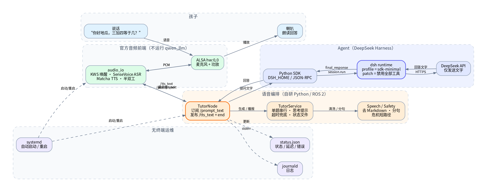

# 小地瓜老师：RDK MagicBox 语音学习助手

> 目标：把 RDK X5 MagicBox 变成一个**只有语音输入、喇叭输出**的小学生学习助手。  
> Agent：DeepSeek Harness Python SDK（`sdk-minimal` profile）。  
> 交互：说“你好地瓜”唤醒 → 直接提问 → 喇叭回答 → 说“结束对话”休眠。  
> 原则：**产品运行时没有终端界面，不读 stdin，不打印对话到 stdout。**

## 1. 它是什么、不是什么

**是：**

- 一台放在书桌上的小学 1—6 年级学习助手。
- 用官方 `audio_io` 做唤醒词、ASR、TTS，用 DeepSeek Harness 做对话 Agent。
- 支持多轮对话、数学分步提示、语文/英语讲解、鼓励式反馈。
- 有确定性的安全短路径：自伤、被欺负、火灾/触电等高风险话术不交给模型自由发挥。
- 无工具 Agent：模型不能读写文件、执行 shell、上网或改设备。

**不是：**

- 不是家教替代品，不保证答案 100% 正确。
- 不是离线模型；ASR/TTS 在板端，**识别后的文字会发给 DeepSeek API**。
- 不是安全监护设备；高风险情况只能引导孩子找大人/拨打 110、119、120。
- 不是“直接代写作业”的工具；人设要求先给思路和第一步。
- 不接管实体按键：官方按键逻辑属于已停用的 `magicbox-start`，唤醒入口是 KWS。

## 2. 系统架构



数据流：

1. 孩子说“你好地瓜”，`audio_io` 的 KWS 唤醒，蓝灯亮起，麦克风打开。
2. 孩子提问，`audio_io` 用 SenseVoice 做 ASR，把文字发到 `/prompt_text`。
3. 自研 `TutorNode` 订阅文字，交给 `TutorService`；同一时间只处理一道题。
4. `DSHTutorAgent` 通过 Python SDK 启动 `dsh --profile sdk-minimal`，把问题送进持久 Session。
5. DSH 调用 DeepSeek 模型，返回最终文字；模型没有 shell/文件/网页工具。
6. `Speech` 清洗 Markdown、代码、URL、表情，把数学符号转成中文，按句切分。
7. `TutorNode` 逐句发布到 `/tts_text`，由 `audio_io` 的 Matcha TTS 播放；最后发 `"end"` 让麦克风重新打开。
8. 孩子说“结束对话”，`audio_io` 自己进入休眠，助手不再收音。

### 为什么保留 `audio_io`，不自己写 ALSA

- 官方已经适配 MagicBox 的 I2S 麦克风/功放、KWS、SenseVoice、Matcha TTS、半双工和灯效。
- 自己用 `sounddevice`/`arecord` 重写会引入设备号、重采样、回声、模型路径等一堆问题。
- 我们只替换“大模型节点”：不启动 `qwen_llm`，把 `/prompt_text` 接到 DSH，把 DSH 的回答接回 `/tts_text`。

### 为什么用 `sdk-minimal` 而不是 `sdk` / `web`

`sdk-minimal` 是纯对话 + 持久会话 + 自动压缩的最小组合；它仍然默认带一个 `bash` 工具，因此必须叠加 `patches/voice-only.yml`：

```yaml
- id: persistent-bash
  disabled: true
- id: persistent-pwsh
  disabled: true
- id: tool-fs
  disabled: true
- id: tool-working-directory
  disabled: true
```

这样模型**没有任何模型可调用的工具**。即使孩子说“把文件删掉”或“打开网页”，Agent 也只能用文字回答，不能执行。`sdk` profile 带有大量编码工具，不适合儿童设备；`web` 不是 SDK server，不能作为这个链路的后端。

### 为什么用持久 Session

- 多轮对话需要上下文：“那 7 乘 8 呢？”要知道上一题。
- 每问一句重启 `dsh` 进程会慢很多，也会丢失上下文。
- `sdk-minimal` 自带自动压缩，长对话不会无限增长。
- 进程重启后，默认从 `state/session_id` 读取上次的 Session ID，并用 `resume_session()` 恢复历史；说“重新开始 / 新对话 / 换个话题”才会主动新建 Session。
- 会话旁边会写 `session_id.meta.json`，记录 provider、model 和人设哈希。切换 DeepSeek/Qwen、换模型或改人设时，旧会话不会强行恢复，而是自动新建，避免旧历史把新模型带偏。
- 如果模型对较长问题只回 1—2 个字，助手会重置会话并重试一次；仍过短就按兜底处理，不会把单字当完整回答反复播放。
- 如果 Session 因 DSH 升级、profile 变化、工作目录变化、文件损坏或被占用而无法恢复，会**自动新建**一个，并在 journal 里记录原因；旧 JSONL 仍留在 DSH home 里。
- 不想跨重启保留历史时，把 `agent.resume_session` 设为 `false`。

### 模型平台：DeepSeek 与千问百炼

默认使用 DeepSeek；也可以换成阿里云百炼的 Qwen。**不能只改 `DEEPSEEK_BASE_URL`。** DSH 的 `sdk-minimal` 默认 `llm-deepseek` 适配器走 Anthropic Messages 协议；百炼兼容模式是 OpenAI Chat Completions，两者报文不同。正确做法是加载 `patches/qwen-bailian.yml`，用 `llm-pi-ai` 注册 Qwen 路由。

按 key 类型选路由：

| Key 类型 | provider | 环境变量 |
|---|---|---|
| Token Plan 个人订阅（中国站） | `qwen-token-plan-cn` | `QWEN_TOKEN_PLAN_CN_API_KEY` |
| Token Plan 个人订阅（国际站） | `qwen-token-plan-individual` | `QWEN_TOKEN_PLAN_API_KEY` |
| 普通百炼 API Key | `qwen` | `DASHSCOPE_API_KEY` |

Token Plan 路由直接使用 pi-ai 内置目录（含 `qwen3.8-flash` / `qwen3.7-plus` / `qwen3.7-max`），不需要在 patch 里逐条列模型。普通 `qwen` 路由是手工声明的 OpenAI-compatible 端点，模型需要写在 `models` 列表里。

对应配置（中国站个人订阅）：

```yaml
agent:
  provider: qwen-token-plan-cn
  model: qwen3.8-flash
  api_key_env: QWEN_TOKEN_PLAN_CN_API_KEY
  provider_patch_file: /opt/magicbox-tutor/patches/qwen-bailian.yml
```

`patches/qwen-bailian.yml` 同时禁用 `deepseek-llm-api-extensions` 和 `plugin-package-inventory-deepseek`，避免 DeepSeek 专用请求字段影响 Qwen 路由。安全补丁 `voice-only.yml` 仍然生效，模型依旧没有工具。

## 3. 一次对话的状态

| 状态 | 触发 | 设备表现 |
|---|---|---|
| IDLE | 启动完成 / 回答结束 | 白灯呼吸，等待唤醒 |
| LISTENING | 听到“你好地瓜” | 蓝灯常亮，麦克风开 |
| THINKING | ASR 文字到达 | 蓝灯呼吸/思考；1.5 s 后说“让我想一想” |
| SPEAKING | 回答开始 | 喇叭逐句播放；麦克风关闭 |
| IDLE | 发完 `end` | 麦克风重新打开，可继续追问 |
| 休眠 | 孩子说“结束对话” | `audio_io` 进入呼吸灯，等待下次唤醒 |
| 超时 | 75 s 没有答案 | 说“这个问题有点难……”；模型线程结束后才接受下一题 |

## 4. 语音体验设计

### 唤醒与多轮

- 默认 `continuous_wake_mode:=false`：先说“你好地瓜”唤醒，然后可以连续追问，不必每句都带唤醒词。
- 说“结束对话”后，`audio_io` 休眠；下次再说“你好地瓜”。
- 不启用“边播边说”的 barge-in：单麦、无硬件 AEC，边播边听会自问自答。

### 回答长度

- 人设要求默认 2—4 句、最多 120 字；`max_answer_chars=600` 是硬上限，防止模型失控。
- 每句最多 80 字，避免 TTS 一次读一大段。
- `audio_io` 会给每条 TTS 文本自动补“。”，所以发布前会去掉句末标点，避免“。。”。

### 思考提示

模型首 token 可能要几秒。1.5 s 后如果还没有答案，先播“让我想一想”，避免孩子以为设备坏了。如果答案在 1.5 s 内到达，不会播这句。

> **延迟边界：** DSH Python SDK 的 `run()` 返回的是最终回答，不是逐 token 流。因此这里的“逐句”是**合成/播放层面**的优化：首句不必等整段 TTS 合成，但首句仍要等模型整轮完成。若要把首句延迟压到 token 级，需要改用 DSH 的流式事件源或另接模型流式接口。

### 超时

- `answer_timeout_s=75`：超时先播兜底话术。
- 超时后模型线程可能还在跑；它返回的答案会被丢弃，等服务空闲后才接受下一题，避免两个答案同时播。
- 如果经常超时，先检查网络/API key，再考虑换更快的模型或缩短回答。

## 5. 安全设计

### 5.1 无工具

这是最重要的一条：**语音输入不可信**。孩子可能转述别人的话，也可能说“忽略之前的指令”。  
`voice-only.yml` 禁用了 shell、文件、工作目录工具；`sdk-minimal` 本身也没有 web/subagent/plugin 工具。模型即使被诱导，也没有可执行能力。

### 5.2 确定性安全短路径

在交给模型之前，`safety.py` 检查三类高风险表达：

- 自伤/自杀：先安抚，要求马上找信任的大人，必要时 110/120。
- 被欺负/被打/被摸：明确“不是你的错”，要求找大人保护，必要时 110。
- 火灾/触电/煤气/陌生人闯门：先离开危险处，找大人，拨打 119/110/120。

这些回答是固定话术，不依赖模型，避免模型在危机场景里“自由发挥”。

### 5.3 人设护栏

`config/tutor_system_prompt.md` 要求：

- 不询问/重复/保存真实姓名、学校、住址、电话、照片。
- 不讨论色情、暴力、恐怖、赌博、毒品、自伤方法。
- 不推荐充值、网购、外部链接、账号密码。
- 不直接代写作业；先给思路和第一步。
- 不贴“笨/懒”标签，不比较孩子。
- 不知道就说不知道。

### 5.4 隐私

- 音频在板端被 ASR 成文字；**音频本身不上传**。
- 识别后的文字和对话上下文会发给 DeepSeek API。
- DSH 会在 `dsh_home` 下持久化会话 JSONL；权限 700。
- 默认 `log_transcripts: false`：journal 只记录字数、耗时、错误类型，不记录孩子原话。
- `voice-only.yml` 禁用 `session-log-deepseek`，不把未接受的会话日志事件上传给模型提供方。
- 家长说“重新开始”可切新会话；维护者可用 `scripts/purge_sessions.sh` 清理旧会话（见部署文档）。

## 6. 性能与资源

| 项目 | 预算/说明 |
|---|---|
| ASR/TTS | 官方 `audio_io`，SenseVoice fp16 + Matcha；占用见官方基线 |
| DSH 运行时 | 约 300 MB 的可执行文件 + Node 运行时；启动一次后常驻 |
| 内存 | 8 GB 板端；`audio_io` + DSH + Python 预计 1—2 GB，需实测 |
| 首答延迟 | 取决于网络/模型；有 1.5 s 思考提示 |
| 连续运行 | 2 h soak；systemd 自动重启 |
| 存储 | DSH 会话 JSONL 会增长；定期清理或压缩 |

> 这些是预算，不是实测承诺。第一周应记录实际首答延迟、内存、温度。

## 7. 失败与降级

| 故障 | 表现 | 处理 |
|---|---|---|
| 没有声卡 | `audio_io` 启动失败，服务重启 | 检查排线/设备树；`arecord -l` |
| 没有 API key | 每轮回答失败，播“小脑袋卡住” | 填 `/etc/magicbox-tutor.env`，重启 |
| 网络断开 | 模型超时，播兜底话术 | 检查网络；本地 ASR/TTS 仍可用 |
| DSH 启动失败 | 日志有 `DSH 运行时启动失败` | 检查 venv、profile、patch、DSH home 权限 |
| TTS 不响 | 日志有 TTS 发布但无声音 | 检查 `hw:0,0`、音量、`audio_io` 是否在跑 |
| 唤醒不灵 | 说唤醒词没反应 | 检查 KWS 模型、麦克风、噪声；本项目不接管实体按键 |
| 服务反复重启 | `systemctl status` 显示失败 | 看 `journalctl -u ...` 的第一条错误 |

## 8. 代码结构

```text
src/magicbox_tutor/
├── __main__.py       # 无终端入口；--check 仅做配置校验
├── config.py         # YAML + 环境变量
├── agent.py          # DSH Python SDK 适配、Session、无工具补丁
├── dialog.py         # 归一化、重置词、安全短路径
├── safety.py         # 高风险话术
├── speech.py         # Markdown/URL/公式清洗、分句、长度限制
├── service.py        # 单题串行、思考提示、超时、TTS 发布
├── ros_node.py       # /prompt_text -> /tts_text 的 ROS 2 桥
└── status.py         # 无转录状态文件
```

## 9. 后续可扩展

- 自定义唤醒词“你好小地瓜”：替换 KWS `keywords.txt` 并重新标音，需在板端验证。
- 年级/科目配置：在启动时问一次“你今天几年级”，写入 Session 首条上下文。
- 家长端只读状态页：读取 `/run/magicbox-tutor/status.json`，不暴露对话内容。
- 本地小模型 fallback：网络断开时用板端 Qwen2.5-1.5B 兜底，但 1.5B 事实性弱，需谨慎。
- 多语言：当前人设以中文为主；英语单词可读，完整英文对话需另做 TTS 评估。

## 10. 相关文档

- [部署与排障](部署与排障.md)
- 重启后排障：先看 `journalctl -u magicbox-tutor` 的第一条 `DSH 运行时启动失败`；`EROFS` 表示根文件系统只读，不是 API key 问题。
- [项目 README](../README.md)
- [此前的方案与选型](方案与选型.md)
